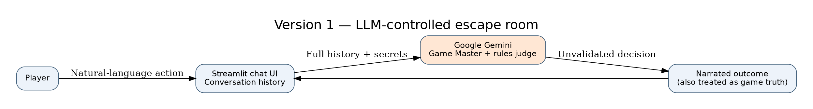
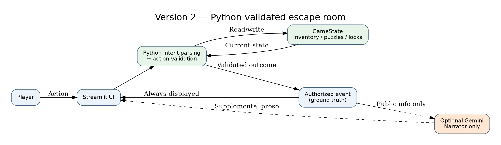

# AI-Powered Escape Room — The Clockwork Library

A Python/Streamlit escape-room game built for **Mini Project 01: AI-Powered Escape Room**. The player wakes inside a library enchanted by **Morvan**, a wizard who offers freedom in exchange for solving his puzzles.

The project has two independently runnable versions. They share the same setting, imagery, opening sequence, and dialogue presentation, while assigning authority over gameplay differently.

| | Version 1: Interactive AI Escape Room | Version 2: Reliable AI Escape Room |
| --- | --- | --- |
| Rules authority | Gemini interprets actions and decides outcomes | Python validates actions and changes game state |
| Progress storage | Conversation history; separate visual-only scene markers | `GameState` with inventory, puzzle flags, locks, and action history |
| LLM information | Scenario, secret solutions, and full conversation | Public state, player request, and an already-authorized event |
| Offline gameplay | Requires Gemini for meaningful gameplay | Puzzle engine works without an API key |
| Invalid/adversarial actions | Depends on the model's response | Deterministic checks handle the implemented cases |
| Success | Wizard reports `ESCAPED!` | Python opens the door; chat input becomes disabled |

## Contents

- [Deliverables](#deliverables)
- [Features](#features)
- [Requirements and installation](#requirements-and-installation)
- [API configuration](#api-configuration)
- [Running the applications](#running-the-applications)
- [Playing the game](#playing-the-game)
- [Architecture and state](#architecture-and-state)
- [Testing and comparison evidence](#testing-and-comparison-evidence)
- [Building the report](#building-the-report)
- [Project structure](#project-structure)
- [Customization](#customization)
- [Troubleshooting](#troubleshooting)
- [Limitations](#limitations)
- [References and media credits](#references-and-media-credits)

## Deliverables

| Assignment deliverable | Project artifact |
| --- | --- |
| Working LLM-controlled application | [version1/app.py](version1/app.py) |
| Improved application with explicit state and validation | [version2/app.py](version2/app.py), [version2/engine.py](version2/engine.py) |
| Architecture diagram for each version | [Version 1 diagram](diagrams/version1.svg), [Version 2 diagram](diagrams/version2.svg); PNG and DOT sources are also included |
| At least five comparative test cases | Seven recorded scenarios in [comparison evidence](evaluation/comparison_results.json) and [readable results](evaluation/comparison_results.md) |
| Short report of 2–3 pages | [Three-page PDF](Mini_Project_Report.pdf), [editable Markdown report](Mini_Project_Report.md) |
| Reproducible installation and usage | This README, [runtime dependencies](requirements.txt), and [report dependencies](requirements-report.txt) |

The project does not train or fine-tune a model. It uses an existing Gemini API and ordinary local Python execution.

## Features

- A six-second awakening using the selected Pinterest starry-sky video beneath drifting mist, followed by a fade into the library.
- Morvan's wizard persona, a natural-language chat interface, and a clear restart control: **Wake again**.
- Six interactive objects: bookshelf, painting, desk, clock, drawer, and brass door.
- A hidden-key discovery, a drawer-code puzzle, and a final four-digit exit challenge.
- Four locally stored library images. Images change at clue milestones and crossfade every **45 seconds without progress**. Ordinary reruns preserve that timer.
- A custom Streamlit component that types the newest wizard message after the opening. **Show all**, **Replay text**, and **Read transcript** keep dialogue accessible.
- Optional Gemini speech: **Read aloud · magical voice** automatically narrates new replies; **Hear the wizard** requests the current reply. A short echo creates a library-like resonance, and the audio player supports pause/replay.
- Reduced-motion preferences skip the opening and reveal text immediately. The scene slideshow remains active.
- Version 2 displays its public state in **Your discoveries** and always shows the authoritative **Library event** separately from the wizard's prose.

The opening and scenery use downloaded local media. Gameplay does not need a Pinterest or Zedge connection. AI text and speech requests do need internet access.

## Requirements and installation

The verified environment uses **Python 3.14.5**. Use that version for the closest reproduction. Other Python/dependency combinations have not been verified; current dependencies have different minimum Python versions. A modern browser is required for the interface, local video, and audio playback. No GPU or model training is needed. Exact versions from this run are recorded in [evaluation/environment.json](evaluation/environment.json).

Run commands from the project root, the directory containing `README.md`.

### macOS / Linux

```bash
cd AI_Escape_Room
python3 -m venv .venv
source .venv/bin/activate
python -m pip install -r requirements.txt
```

### Windows PowerShell

```powershell
cd AI_Escape_Room
py -m venv .venv
.\.venv\Scripts\Activate.ps1
python -m pip install -r requirements.txt
```

Activation is optional when using the virtual environment's interpreter directly. On macOS/Linux, replace `python` with `.venv/bin/python`; on Windows, use `.\.venv\Scripts\python.exe`.

| Dependency | Purpose |
| --- | --- |
| `streamlit` | Chat interface, browser media delivery, session state, and component hosting |
| `google-genai` | Gemini text generation and optional speech synthesis |
| `numpy` | PCM audio processing and the short echo effect |
| `pytest` | Automated engine, UI, timing, and audio checks |
| `reportlab` | Optional PDF report generation; installed through `requirements-report.txt` |

Dependency ranges are defined in the requirements files; there is no exact-version lockfile. The report describes the verified run rather than claiming compatibility with every possible future dependency version.

## API configuration

Version 1 needs a Gemini API key. Version 2's puzzle engine does not need a key; a key enables optional wizard narration and speech.

Choose **one** credential method. The environment variable takes precedence over Streamlit secrets.

### Environment variable

macOS/Linux:

```bash
export GEMINI_API_KEY='YOUR_GEMINI_API_KEY'
```

Windows PowerShell:

```powershell
$env:GEMINI_API_KEY = "YOUR_GEMINI_API_KEY"
```

### Local Streamlit secrets

Create `.streamlit/secrets.toml`:

```toml
GEMINI_API_KEY = "YOUR_GEMINI_API_KEY"
```

The secrets file is ignored by Git. `.streamlit/config.toml` contains the shareable theme configuration and does not contain the key. The application does not automatically load a `.env` file.

### Model settings

| Setting | Default in this project | Purpose |
| --- | --- | --- |
| `GEMINI_API_KEY` | None | API authentication; alternatively set it in Streamlit secrets |
| `GEMINI_MODEL` | `gemini-3.8-flash` | Wizard text model |
| `GEMINI_TTS_MODEL` | `gemini-3.1-flash-tts-preview` | Optional text-to-speech model |

`GEMINI_MODEL` and `GEMINI_TTS_MODEL` are read from environment variables, not Streamlit secrets. For example:

```bash
export GEMINI_MODEL='gemini-3.8-flash'
export GEMINI_TTS_MODEL='gemini-3.1-flash-tts-preview'
```

These identifiers describe the code's configured defaults. Provider model availability and account quotas can change. The assignment prohibits paid APIs: use only models and quotas available to your account at no charge. The project does not enable billing, but it also does not enforce a provider spending cap. Speech uses a separate request and may have different availability; leave read-aloud off when free speech access is unavailable.

Text requests use a 20-second timeout, one SDK attempt, and an output budget of 1,024 tokens. Gemini 3 text models use low thinking. Speech requests use a 30-second timeout and one SDK attempt.

## Running the applications

Start each version in a separate terminal from the project root.

### Version 1

```bash
python -m streamlit run version1/app.py --server.address 127.0.0.1 --server.port 8501
```

Open **http://127.0.0.1:8501**.

### Version 2

```bash
python -m streamlit run version2/app.py --server.address 127.0.0.1 --server.port 8502
```

Open **http://127.0.0.1:8502**.

Press `Ctrl+C` in the corresponding terminal to stop a server. The commands above bind the apps to the local computer.

For offline Version 2 gameplay, start without `GEMINI_API_KEY` in either the environment or `.streamlit/secrets.toml`, and leave speech disabled. If a configured API fails, Version 2 still retains the Python outcome, although the optional request can delay the displayed response until its timeout.

## Playing the game

1. Let the awakening fade, then read or listen to Morvan's introduction.
2. Enter an action in the chat box, such as `examine the bookshelf`.
3. Investigate objects, collect discovered items, and combine the clues.
4. Use the drawer dial and the door keypad when you have their codes.
5. Choose **Wake again** to clear game progress and replay the opening.

Version 2 accepts a defined set of natural-language patterns. Useful examples are:

```text
look around
examine the bookshelf
examine the red book
take the key
inventory
use key on the book clasp
inspect the painting
open drawer with code 314
take the page
examine the desk
examine the clock
solve the puzzle
enter code 7426 on door
```

`inventory`, `bag`, and `what do I have` inspect collected items. `help` and `look around` repeat the introduction. Some alternative phrasings are unsupported; use an explicit action verb and object name when needed.

### Puzzle design and walkthrough — spoilers

<details>
<summary>Show the puzzle solutions and complete walkthrough</summary>

| Object | Clue or interaction |
| --- | --- |
| Bookshelf | Red, blue, and green books; the red book reveals a small brass key |
| Painting | Frame digits `3 - 1 - 4`, the drawer combination |
| Drawer | Code `314` reveals a loose page marked `4` |
| Desk | Order: clock, page, compass, candle; compass value `2` |
| Clock | Clock value `7`; a candle on its face is marked `6` |
| Door | Four-digit keypad; combine the ordered values as `7426` |

A full walkthrough is:

```text
examine red book
take key
use key on the book clasp
examine painting
open drawer with 314
take page
examine desk
examine clock
open door with 7426
```

In Version 2, opening the drawer requires discovering the painting clue and entering `314`. The final validator requires solved flags for `book`, `painting`, `drawer`, `desk`, and `clock`, plus code `7426`. The current exit check does **not** separately require that the key and page are in inventory; following the full walkthrough collects them, but those inventory dependencies are a documented improvement opportunity. The drawer itself uses a code, not the key.

After a valid exit, Version 2 prints `ESCAPED!`, sets `door_open=True`, records the `exit` flag, and disables further chat input. Version 1 relies on the wizard's own success statement and leaves chat available.

</details>

## Architecture and state

### Version 1: the LLM decides



The UI stores the conversation in `st.session_state.v1_messages`. The exact system prompt in `version1/app.py` contains Morvan's persona, object descriptions, puzzle sequence, and secret answers. Each player message and the conversation are sent to Gemini. Its reply supplies both the story and the gameplay decision.

There is no independent inventory or puzzle validator in Version 1. Its scene-stage marker is presentation-only and is inferred from the wizard's prose; it does not make the game state reliable. Version 1 intentionally follows the assignment's normal-player scope.

### Version 2: Python decides



The UI passes the player's text to `process_action(state, action)`. That function recognizes supported intents, checks prerequisites, and changes the dataclass only when the implemented rules allow the action. It returns an exact event string.

If narration is available, Gemini receives the player's request, that authorized event, and `state.public_view()`. The system does not send the complete room configuration or all secret solutions to the narrator. A discovered clue may legitimately appear in a public event. Generated narration is displayed separately and is never parsed to update the state.

The model can still say something misleading, including falsely claiming that the player escaped. The authoritative state and **Library event** remain the source of truth. A test deliberately supplies a false `ESCAPED!` narration and verifies that the door and scenery do not advance.

### Structured state

| `GameState` field | Meaning |
| --- | --- |
| `examined` | Set of object names already inspected |
| `inventory` | Set of collected item names |
| `unlocked_drawer` | Whether the drawer is open |
| `solved` | Set of completed clue/puzzle identifiers |
| `door_open` | Whether Python has authorized escape |
| `history` | Submitted actions, each recorded with a 400-character limit |

`public_view()` returns JSON-friendly values: sorted object/item/puzzle lists and the lock flags. It does not return the full action history or the canonical configuration.

Chat, state, dialogue markers, generated audio, and timers are held in Streamlit session memory. There is no database, user account system, or durable saved-game feature. A new session or server restart can lose progress.

### Shared presentation and voice

The custom component in `shared/ui/index.html` reveals text in the browser and reports its height to Streamlit. Model text is inserted with `textContent`; it is not evaluated as HTML or JavaScript. Scenery animation runs in CSS and makes no background model calls.

Speech generation uses the `Algenib` prebuilt voice with wizard-style direction. NumPy adds three quiet echoes at 90, 190, and 320 milliseconds, normalizes the result to avoid clipping, and writes mono 16-bit WAV audio. Speech reads Morvan's dialogue; Version 2's separate library event is excluded from the spoken transcript.

Audio is opt-in. Successful clips are cached in session memory, and failed automatic attempts are not repeated on every rerun. **Hear the wizard** permits a manual retry. Browser playback controls remain available when autoplay is restricted.

## Testing and comparison evidence

### Automated checks — no model calls

```bash
python -m pytest -q
```

The recorded verification contains **18 passing tests**. The UI tests replace external model functions locally; a passing UI test is not a claim about a live model's answer.

| Test file | Tests | Coverage |
| --- | ---: | --- |
| `tests/test_engine.py` | 8 | Uncollected key, incorrect drawer code, false progress, administrator impersonation, secret requests, nonexistent objects, premature exit, valid escape/replay lock |
| `tests/test_scenery.py` | 4 | Idle clock persistence, progression/restart timing, trusted milestones, and Version 1 visual-only progress |
| `tests/test_apps.py` | 2 | Wizard prompt/progress/restart and prevention of narrator-authorized escape |
| `tests/test_dialogue.py` | 4 | Spoken-text separation, WAV/echo validity, opt-in cached speech, and graceful speech failure |

A machine-readable test run is saved in [evaluation/pytest-results.xml](evaluation/pytest-results.xml). To refresh that evidence:

```bash
python -m pytest -q --junitxml=evaluation/pytest-results.xml
```

### Live comparison cases

[comparison_results.json](evaluation/comparison_results.json) stores prompts, real Version 1 responses or provider error codes, and Version 2 before/after states. [comparison_results.md](evaluation/comparison_results.md) presents the same evidence for review. Cases cover the five example challenges in the assignment plus nonexistent-object and premature-exit checks.

In the recorded run on **17 November 2026**, Version 1 declared an unearned escape for the false-progress claim and the immediate correct-code request; it resisted the other five challenges. Version 2 rejected all seven invalid actions without changing public state. Three initial provider errors were preserved and successfully retried.

Each case starts from a fresh game. For the wrong-code case, both versions independently examine the painting first. Version 1 is queried with the exact app system prompt; its recorded text is qualitatively reviewed, not automatically judged by a keyword score. Version 2 runs its real deterministic engine without optional narration. Its action history advances even when its public state stays unchanged.

To repeat the live evaluation using your configured key:

```bash
python scripts/evaluate_comparison.py
# Optional: retry failed requests while retaining the earlier error records.
python scripts/evaluate_comparison.py --retry-errors
```

This makes seven challenge requests plus a painting-setup request. It does not generate speech or enable billing. It overwrites the comparison JSON, records provider failures without treating them as game-rule failures, and uses the configured text model. `--retry-errors` retries only cases without a successful response and preserves their previous attempts. Results are a small, model-dependent sample, not a general jailbreak-resistance benchmark. If the JSON changes, review the new transcripts, update the case observations in `evaluation/comparison_review.json`, and refresh its `source_sha256` before rebuilding. The report generator refuses a stale review rather than reusing old conclusions.

The recorded browser checks additionally verified opening-video playback/fade/restart, clue-driven and idle scenery changes, text typing/skip/replay, panel sizing, literal rendering of HTML-like model text, mobile layout, reduced-motion behavior, and live speech playback. Browser QA was performed manually through an automated local browser session; it is not part of `pytest` and no portable browser-test runner is shipped.

## Building the report

Install the optional report dependency and regenerate the report from the saved evidence:

```bash
python -m pip install -r requirements-report.txt
python create_report.py
```

The generator writes:

```text
Mini_Project_Report.pdf
Mini_Project_Report.md
evaluation/comparison_results.md
```

It reads the live comparison JSON, its fingerprinted qualitative review, and pytest XML. The PDF draws compact vector architecture diagrams; the Markdown copy links the supplied diagram PNGs. Report generation itself makes no API calls. Markdown is the editable narrative copy; changes made only to generated files will be replaced on the next build. Update the content in `create_report.py` to make reproducible edits. When changing live evidence, review both the case summaries and the report conclusions; the current findings describe the supplied run. Compute the new review fingerprint only after checking the new responses:

```bash
python -c "import hashlib,pathlib; print(hashlib.sha256(pathlib.Path('evaluation/comparison_results.json').read_bytes()).hexdigest())"
```

 No student name or student identifier is invented; add your required identification before submission.

## Project structure

```text
AI_Escape_Room/
├── version1/
│   └── app.py                     # LLM-controlled game and wizard system prompt
├── version2/
│   ├── app.py                     # Validated UI and optional wizard narration
│   └── engine.py                  # GameState, intent recognition, and rules
├── shared/
│   ├── config.py                  # Story, objects, and canonical puzzle answers
│   ├── llm.py                     # Gemini text adapter and key lookup
│   ├── appearance.py              # Video opening, scene display, and source links
│   ├── scenery.py                 # Presentation milestones and idle timing
│   ├── dialogue.py                # Typed dialogue and speech controls
│   ├── speech.py                  # Gemini speech, echo, and WAV encoding
│   └── ui/index.html              # Browser-side typing component
├── assets/                        # Local images/video and media-source records
├── diagrams/                      # Version 1/2 diagrams in DOT, SVG, and PNG
├── tests/                         # 18 automated tests
├── scripts/evaluate_comparison.py # Live side-by-side challenge recorder
├── evaluation/                    # Recorded comparisons and pytest evidence
├── .streamlit/
│   ├── config.toml                # Theme configuration
│   └── secrets.toml               # Optional local credential; ignored by Git
├── requirements.txt              # Application and test dependencies
├── requirements-report.txt       # Application plus PDF-generation dependency
├── create_report.py              # Reproducible three-page report generator
├── Mini_Project_Report.pdf        # Submission report
└── Mini_Project_Report.md         # Editable report copy
```

## Customization

| Change | Location |
| --- | --- |
| Wizard name, persona, introduction, object descriptions | `shared/config.py` |
| Drawer or exit answer | `shared/config.py`; review engine conditions and tests together |
| Version 1 rules prompt | `SYSTEM` in `version1/app.py` |
| Accepted phrases, prerequisites, item use, and state transitions | `version2/engine.py` |
| Library images, scene captions, overlay styling, media credits | `shared/appearance.py` and `assets/` |
| Opening duration or idle interval | `WAKE_SECONDS` / `IDLE_SECONDS` in `shared/scenery.py` |
| Typing speed, punctuation pauses, and component styles | `shared/ui/index.html` |
| Speech voice/style/echo | `shared/speech.py` |
| Theme colors | `.streamlit/config.toml` |

When changing the number of scenes, also revise the slideshow's percentage keyframes, which currently assume four equal phases. Replacing the files alone does not change the canonical puzzle logic. After editing shared Python modules, restart both servers if an imported module remains cached.

## Troubleshooting

| Symptom | Check or action |
| --- | --- |
| `No module named streamlit` | Activate the correct virtual environment and install `requirements.txt` with that interpreter |
| Version 1 says no key is configured | Set `GEMINI_API_KEY` through one of the supported methods; restart the server if environment variables changed |
| Model unavailable / 404 | Select a text model available to your account using `GEMINI_MODEL`; text and TTS model identifiers are different |
| Rate limit, timeout, or temporary provider failure | Retry later; check the account's free quota and model access; Version 2's Python gameplay remains available |
| Speech fails while chat works | Check `GEMINI_TTS_MODEL` and speech access; leave read-aloud off and continue with typed text |
| Audio does not begin automatically | Press play in the displayed audio player |
| A natural-language action is ignored in Version 2 | Try one of the documented verb/object examples; the parser is deliberately limited |
| Opening is absent | Reduced-motion mode skips it; otherwise choose **Wake again** to replay |
| Updated shared code is not visible | Stop and restart both Streamlit processes, then refresh the browser |
| Port is already in use | Stop the process using it or choose another `--server.port` |
| Report generation cannot import ReportLab | Install `requirements-report.txt` in the same environment |
| Missing or mismatched evidence | Regenerate pytest XML / live JSON, then run `python create_report.py` |

## Limitations

- Version 1 has no independently validated game state. A correct answer in one live trial does not guarantee the same response on another run.
- Version 2 validates supported actions but is not a general natural-language interpreter. Its adversarial checks cover representative phrases, not all possible attacks.
- Gemini's narration and speech can still contradict facts in prose. The Version 2 engine and displayed library event remain authoritative.
- Final-door validation currently requires clue flags and the correct code, rather than separately requiring collected key/page items. A complete puzzle dependency graph would strengthen the design.
- Sessions are temporary. There is no persistent save/load, authenticated multiplayer, or deployment configuration.
- Provider access, quota, model availability, and output quality are external dependencies. Optional voice is a presentation enhancement, not required for solving the room.
- Images depict a fictional atmosphere; visible architectural details do not create additional interactive puzzle objects.
- Broad dependency ranges and small live test samples limit exact reproducibility. Recorded model identifiers, timestamps, full responses, and test evidence make those limits reviewable.

## References and media credits

- [Assignment report](Mini_Project_Report.pdf) and [recorded comparative evaluation](evaluation/comparison_results.md).
- [Streamlit chat documentation](https://docs.streamlit.io/develop/api-reference/chat).
- [Gemini API documentation](https://aistudio.google.com/docs) and [speech-generation documentation](https://aistudio.google.com/docs/speech-generation).
- [pytest usage documentation](https://docs.pytest.org/en/stable/how-to/usage.html).
- [Media sources, original links, and retained older assets](assets/README.md). The active library images and opening video come from the user-selected Pinterest sources and are stored as downloaded. Media-source metadata is provided; no ownership or redistribution license is implied.
